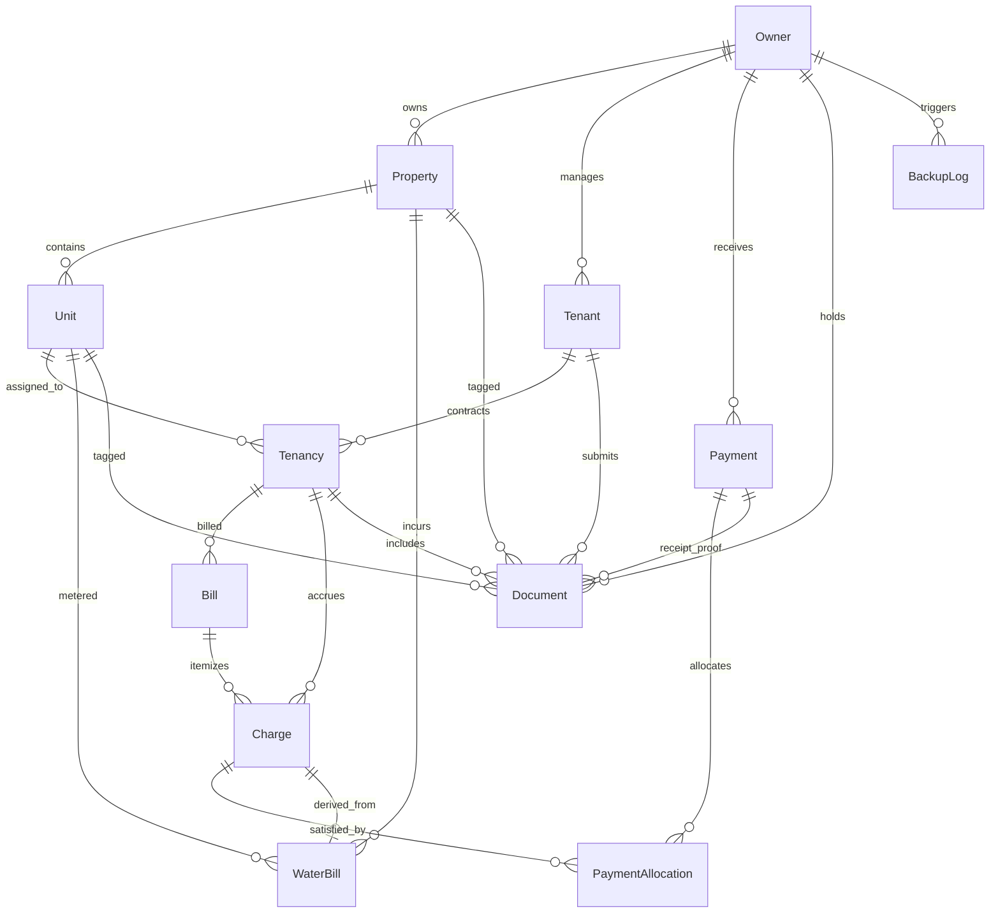

# Database Design & Relational Data Architecture

This document defines the relational database architecture for the **Property Management System (PMS)**. The schema is designed for **PostgreSQL hosted and managed on Supabase** using **Prisma ORM**, emphasizing data integrity, strict multi-tenant owner scoping, financial precision, and immutable historical records.

---

## 1. Managed Database Provider: Supabase PostgreSQL

The PMS uses Supabase exclusively as a **managed PostgreSQL database platform** for Phase 1. 

* **Hosting Model:** Managed PostgreSQL with automated high-availability infrastructure and physical hardware maintenance.
* **Dual-Connection Architecture:**
  1. **Runtime Connection Pooler (`DATABASE_URL`):** Connects to Supabase Supavisor on port `6543` in transaction pooling mode. This allows lightweight, high-concurrency connection multiplexing for Express API endpoints while protecting against PostgreSQL client exhaustion.
  2. **Direct Connection (`DIRECT_URL`):** Connects directly to the PostgreSQL instance on port `5432` with SSL enabled (`sslmode=require`). Used exclusively by Prisma CLI for executing migrations and DDL operations where advisory locks are required.
* **Architecture Boundary:** All domain models, financial constraints, and business logic reside in the Node.js/Express application. Supabase Auth and Supabase Storage are not enabled in Phase 1 and remain future architectural options.

---

## 2. Entity-Relationship (ER) Diagram

---

## 3. Entities, Ownership & Field Definitions

### 2.1 Owner (`Owner`)
Top-level security boundary representing a registered property owner/landlord.
* `id` (`String`, PK, cuid): Unique internal owner identifier.
* `name` (`String`): Full name or business operating name.
* `email` (`String`, Unique): Login email address.
* `phone` (`String?`): Contact telephone number.
* `passwordHash` (`String`): Argon2id or bcrypt hash (cost factor >= 12).
* `currency` (`String`, default `"INR"`): Default display/reporting currency.
* `createdAt` / `updatedAt` (`DateTime`).

### 2.2 Property (`Property`)
Represents an individual physical building, apartment complex, villa, or commercial site.
* `id` (`String`, PK, cuid).
* `ownerId` (`String`, FK -> `Owner.id`): Mandatory owner scoping.
* `name` (`String`): Descriptive name (e.g., *"Lotus Residency"* or *"House #42"*).
* `propertyType` (`Enum`: `RESIDENTIAL_APARTMENT`, `INDEPENDENT_HOUSE`, `PG_HOSTEL`, `COMMERCIAL`).
* `addressLine1`, `addressLine2`, `city`, `state`, `postalCode`.
* `bankDetails` (`String?`): Default account/UPI details printed on tenant bills and receipts.
* `archivedAt` (`DateTime?`): Soft-delete timestamp for archived properties.

### 2.3 Unit (`Unit`)
Represents an individual rentable unit, flat, room, or house.
* `id` (`String`, PK, cuid).
* `propertyId` (`String`, FK -> `Property.id`).
* `unitNumber` (`String`): Identifier unique within the property (e.g. `"101"`, `"Penthouse"`, `"Villa A"`).
* `floorNumber`, `bedrooms`, `bathrooms` (`Int?`).
* `monthlyRent` (`Decimal(12, 2)`): Base asking monthly rent in INR.
* `securityDeposit` (`Decimal(12, 2)?`): Standard security deposit requirement.
* `status` (`Enum`: `AVAILABLE`, `OCCUPIED`, `MAINTENANCE`, `ARCHIVED`).
* `waterMeterId` (`String?`): Sub-meter identifier for metered water tracking.
* `archivedAt` (`DateTime?`).

### 2.4 Tenant (`Tenant`)
Represents an individual renting or leasing units.
* `id` (`String`, PK, cuid).
* `ownerId` (`String`, FK -> `Owner.id`).
* `fullName` (`String`).
* `phone` (`String`): Primary contact number.
* `email` (`String?`): Email for digital statements and receipts.
* `idProofType` / `idProofNumber` (`String?`): Official identification (Aadhaar, PAN, Passport).
* `emergencyContact` (`String?`).
* `archivedAt` (`DateTime?`).

### 2.5 Tenancy (`Tenancy`)
Represents a legal contract binding a Tenant to a Unit across a date range.
* `id` (`String`, PK, cuid).
* `tenantId` (`String`, FK -> `Tenant.id`).
* `unitId` (`String`, FK -> `Unit.id`).
* `moveInDate` (`DateTime`): Effective start date.
* `moveOutDate` (`DateTime?`): Nullable; populated upon formal move-out.
* `agreedRent` (`Decimal(12, 2)`): Agreed rental rate locked at lease signing.
* `securityDeposit` (`Decimal(12, 2)?`).
* `depositPaid` (`Boolean`, default `false`).
* `depositReturned` (`Decimal(12, 2)?`).
* `status` (`Enum`: `ACTIVE`, `ENDED`, `PENDING`).

### 2.6 Current Bill (`Bill`)
Monthly consolidated statement sent to a tenant summarizing all active periodic charges.
* `id` (`String`, PK, cuid).
* `tenancyId` (`String`, FK -> `Tenancy.id`).
* `billNumber` (`String`, Unique): Human-readable invoice number (e.g. `BILL-202610-004`).
* `billingPeriod` (`String`): Period identifier (e.g., `"2026-10"`).
* `issueDate`, `dueDate` (`DateTime`).
* `totalAmount` (`Decimal(12, 2)`): Sum of all linked charge line items.
* `paidAmount` (`Decimal(12, 2)`, default `0.00`).
* `balanceAmount` (`Decimal(12, 2)`): `totalAmount - paidAmount`.
* `status` (`Enum`: `DRAFT`, `ISSUED`, `PARTIALLY_PAID`, `PAID`, `OVERDUE`, `VOID`).

### 2.7 Charge (`Charge`)
Individual financial debits accrued by a tenancy.
* `id` (`String`, PK, cuid).
* `tenancyId` (`String`, FK -> `Tenancy.id`).
* `billId` (`String?`, FK -> `Bill.id`).
* `type` (`Enum`: `RENT`, `WATER`, `ELECTRICITY`, `MAINTENANCE`, `LATE_FEE`, `SECURITY_DEPOSIT`, `OTHER`).
* `description` (`String?`).
* `periodKey` (`String?`): Idempotency key per tenancy (e.g. `"2026-10-RENT"`).
* `amount` (`Decimal(12, 2)`): Non-negative amount debited.
* `dueDate` (`DateTime`).
* `status` (`Enum`: `OPEN`, `PARTIALLY_PAID`, `PAID`, `VOID`).

### 2.8 Water Bill (`WaterBill`)
Utility sub-ledger tracking water consumption and billing calculations.
* `id` (`String`, PK, cuid).
* `propertyId` (`String`, FK -> `Property.id`).
* `unitId` (`String?`, FK -> `Unit.id`).
* `chargeId` (`String?`, Unique, FK -> `Charge.id`).
* `billingPeriod` (`String`): e.g. `"2026-10"`.
* `splitType` (`Enum`: `METERED_READING`, `EQUAL_SPLIT_PER_UNIT`, `OCCUPANT_WEIGHTED`, `FIXED_MONTHLY`).
* `previousReading`, `currentReading`, `consumption`, `ratePerUnit` (`Decimal(10, 2)?`).
* `totalAmount` (`Decimal(12, 2)`).

### 2.9 Payment (`Payment`)
Represents an actual financial credit collected by the owner.
* `id` (`String`, PK, cuid).
* `ownerId` (`String`, FK -> `Owner.id`).
* `receiptNumber` (`String`, Unique): Sequential receipt code (e.g. `REC-2026-0042`).
* `amount` (`Decimal(12, 2)`): Positive monetary sum received.
* `paymentDate` (`DateTime`).
* `method` (`Enum`: `UPI`, `BANK_TRANSFER`, `CASH`, `CHEQUE`, `CARD`, `OTHER`).
* `reference` (`String?`): UTR, check number, or UPI transaction ID.
* `idempotencyKey` (`String?`, Unique): Prevents accidental double-clicking/network duplicate payments.

### 2.10 Payment Allocation (`PaymentAllocation`)
Cross-referencing table linking a payment to specific charges.
* `id` (`String`, PK, cuid).
* `paymentId` (`String`, FK -> `Payment.id`).
* `chargeId` (`String`, FK -> `Charge.id`).
* `amount` (`Decimal(12, 2)`): Portion of payment applied to this specific charge.

### 2.11 Document (`Document`)
Secure file attachments associated with properties, units, tenants, and tenancies.
* `id` (`String`, PK, cuid).
* `ownerId` (`String`, FK -> `Owner.id`).
* `propertyId`, `unitId`, `tenantId`, `tenancyId`, `paymentId` (`String?`, FKs).
* `title` (`String`).
* `category` (`Enum`: `LEASE_AGREEMENT`, `TENANT_ID_PROOF`, `UTILITY_BILL`, `PAYMENT_RECEIPT`, `PROPERTY_TAX_DEED`, `INSPECTION_REPORT`, `OTHER`).
* `fileName`, `fileUrl`, `fileSize`, `mimeType`.

### 2.12 Backup Log (`BackupLog`)
Operational audit record of automated and manual database backups.
* `id` (`String`, PK, cuid).
* `ownerId` (`String`, FK -> `Owner.id`).
* `fileName`, `fileSize` (`BigInt`).
* `backupType` (`String`: `MANUAL` / `SCHEDULED`).
* `status` (`Enum`: `PENDING`, `COMPLETED`, `FAILED`).
* `checksum` (`String?`): SHA-256 hash verifying backup file integrity.

---

## 4. Database Constraints & Performance Indexes

### 4.1 Unique Constraints
1. `Unit`: `@@unique([propertyId, unitNumber])` — A property cannot have two identical unit codes.
2. `Charge`: `@@unique([tenancyId, periodKey])` — Strictly prevents duplicate charges (e.g. two October Rent charges) for the same tenancy.
3. `Bill`: `@@unique([billNumber])` — Unique invoice numbers.
4. `Payment`: `@@unique([receiptNumber])` and `@@unique([idempotencyKey])` — Eliminates race conditions and duplicate payment processing.
5. `PaymentAllocation`: `@@unique([paymentId, chargeId])` — A single payment cannot allocate multiple separate line items to the exact same charge.
6. `WaterBill`: `@@unique([chargeId])` — Exactly one charge is linked to a water billing calculation.

### 4.2 Performance Indexes
* Multi-tenant queries: `@@index([ownerId])` on `Property`, `Tenant`, `Payment`, `Document`, `BackupLog`.
* Financial lookups: `@@index([tenancyId, dueDate])` and `@@index([status, dueDate])` on `Charge` for rapid FIFO payment allocation and overdue calculation.
* Occupancy lookups: `@@index([unitId, status])` on `Tenancy` to quickly filter active tenancies.

---

## 5. Financial Invariants & Integrity Rules

1. **Exact Precision Storage:**
   All monetary amounts use PostgreSQL `NUMERIC(12, 2)` (Prisma `Decimal`). Floating-point types (`float`, `double`) are strictly prohibited in the database schema and application runtime.
2. **Non-Negative Invariant:**
   `Charge.amount > 0.00`, `Payment.amount > 0.00`, and `PaymentAllocation.amount > 0.00`. Negative entries are disallowed at the schema and validation layers. Financial reversals require explicit debit/credit adjustments.
3. **Allocation Balance Invariant:**
   For any given `Payment`:
   $$\sum \text{PaymentAllocation.amount} \le \text{Payment.amount}$$
   (Any unallocated surplus represents unallocated tenant credit).
4. **Charge Settlement Invariant:**
   For any given `Charge`:
   $$\sum \text{PaymentAllocation.amount} \le \text{Charge.amount}$$
   A charge is `PAID` when $\sum \text{allocations} == \text{Charge.amount}$, and `PARTIALLY_PAID` when $0 < \sum \text{allocations} < \text{Charge.amount}$.
5. **Ledger Running Balance Formula:**
   For any tenant at time $t$:
   $$\text{Outstanding Balance} = \sum \text{Valid Charges} - \sum \text{Payment Allocations}$$

---

## 6. Deletion, Archival & Audit Policies

* **RESTRICT Cascades on Financial Paths:**
  `onDelete: Restrict` is enforced across all core foreign keys (`Owner`, `Property`, `Unit`, `Tenant`, `Tenancy`, `Charge`, `Payment`). A property or tenant with associated financial records can never be hard-deleted.
* **Soft Archival (`archivedAt`):**
  Properties, units, and tenants utilize `archivedAt` timestamps. Archived records are excluded from standard active dropdowns and dashboards but remain fully queryable for historic reports, tax filings, and legal disputes.
* **Move-Out Settlement:**
  When a tenant moves out, `Tenancy.status` is set to `ENDED`, and `Unit.status` returns to `AVAILABLE`. The historical tenancy, invoices, receipts, and payments remain intact in perpetuity.

