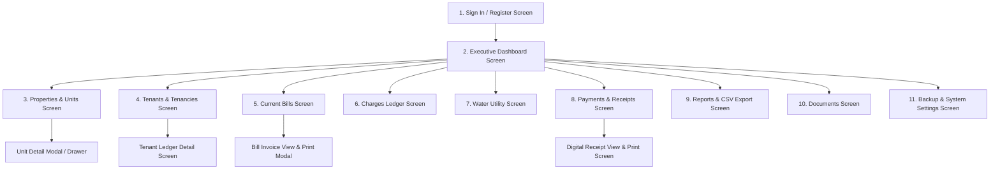

# Screen-by-Screen Specifications & REST API Contracts

**Document Version:** 2.0  
**Status:** Architecture Blueprint & Proposed API Specifications  
*Note: All API contracts in this document are proposed specifications pending implementation in Phase 2 through Phase 6.*

---

## 1. Screen-by-Screen UI & Navigation Architecture

The PMS application features a responsive sidebar/tab navigation layout optimized for mobile smartphones (375px+), tablets (768px+), and desktop workstations (1280px+).



### 1.1 Screen Breakdown

#### Screen 1: Sign In & Registration (`/login`, `/register`)
* **Purpose:** Owner authentication.
* **Key Components:** Clean login card, email/password fields, show/hide password toggle, remember-me checkbox, register toggle with currency selection (default `INR`).
* **Mobile UX:** Full-width thumb-friendly buttons; auto-capitalization disabled for email.

#### Screen 2: Executive Dashboard (`/`)
* **Purpose:** Immediate snapshot of financial health and portfolio occupancy.
* **Key Components:**
  * Metric KPI Cards: Total Units, Occupancy Rate %, Monthly Rent Billed, Payments Collected, Outstanding Arrears.
  * Overdue Rent Table: Tenants with overdue charges sorted by days overdue.
  * Quick Action Floating/Top Bar: *+ Record Payment*, *+ Issue Bill*, *+ Add Tenant*, *+ Add Unit*.

#### Screen 3: Properties & Units (`/properties`)
* **Purpose:** Manage real estate assets, houses, and individual apartments.
* **Key Components:**
  * Property cards with address, property type badge, total units, and active occupancy badge.
  * Unit list / grid with rent amount, status indicator (`AVAILABLE`, `OCCUPIED`, `MAINTENANCE`), and quick actions (*Assign Tenant*, *Edit Rent*).

#### Screen 4: Tenants & Tenancies (`/tenants`, `/tenants/:id`)
* **Purpose:** Tenant directory, KYC records, and tenancy assignments.
* **Key Components:**
  * Searchable table/list of tenants with phone number, current assigned unit, and lease start date.
  * Tenant Profile View: Contact info, identity proofs, active tenancy agreement, and current balance.
  * Tenancy Assignment Modal: Select available unit, enter agreed rent, deposit, and move-in date.
  * Move-Out Dialog: Date of departure, security deposit return calculation, unit restoration.

#### Screen 5: Current Bills (`/bills`)
* **Purpose:** Monthly consolidated tenant invoices.
* **Key Components:**
  * Period filter (e.g. `2026-10`), property filter, status filter (`ISSUED`, `PAID`, `OVERDUE`).
  * Bill Invoice View Modal: Professional itemized statement displaying landlord bank/UPI details, breakdown of rent + water + electricity, and balance.
  * Action: Direct link to *Record Payment* for this bill.

#### Screen 6: Charges (`/charges`)
* **Purpose:** Granular line-item debit management.
* **Key Components:**
  * List of charges by period, type (`RENT`, `WATER`, etc.), amount, and status (`OPEN`, `PAID`).
  * Manual charge addition modal for one-off fees (repairs, penalties, maintenance).

#### Screen 7: Water Bill (`/utilities/water`)
* **Purpose:** Sub-meter readings and split bill calculations.
* **Key Components:**
  * Property-level master bill input (for shared building water bills).
  * Unit-level sub-meter reading entry table (Previous reading pre-filled, enter Current reading $\rightarrow$ auto-computes consumption and cost).
  * One-click action: *Generate & Attach to Current Bills*.

#### Screen 8: Payments & Receipts (`/payments`, `/payments/:id/receipt`)
* **Purpose:** Log incoming tenant money and generate receipts.
* **Key Components:**
  * Payment entry modal: Tenant selector, amount, payment method (UPI, Bank Transfer, Cash), reference number.
  * FIFO allocation preview showing which charges will be settled.
  * Digital Receipt Page: Printable receipt with owner details, tenant name, unit number, payment reference, and running balance.

#### Screen 9: Ledger (`/tenants/:id/ledger`)
* **Purpose:** Complete auditable chronological statement of account.
* **Key Components:**
  * Running balance table: Date, Transaction Type (Charge vs Payment), Reference, Debit, Credit, Net Balance.
  * Date range filter and PDF/CSV export button.

#### Screen 10: Reports & Analytics (`/reports`)
* **Purpose:** Monthly revenue, arrears, and tax accounting reports.
* **Key Components:**
  * Collection report, Arrears report, Occupancy timeline.
  * One-click download: *Export to CSV*.

#### Screen 11: Documents (`/documents`)
* **Purpose:** Secure repository for tenant IDs, lease agreements, and receipts.
* **Key Components:** Filter by property/tenant, drag-and-drop file uploader, preview and secure download buttons.

#### Screen 12: Data Backup (`/settings/backup`)
* **Purpose:** Landlord data security and system recovery.
* **Key Components:** List of previous backups with file size and timestamp, *Create Manual Backup Now* button, download backup archive link.

---

## 2. API Conventions, Authentication & Security Standards

### 2.1 General Conventions
* **Base URL:** `/api/v1`
* **Data Transport:** JSON (`Content-Type: application/json`).
* **Authentication:** Bearer JWT in `Authorization` header or HTTP-only Secure Session Cookie.
* **Owner Scoping (CRITICAL):** Every authenticated request extracts `req.ownerId` from the verified session. Client-supplied `ownerId` in request bodies or query parameters is **strictly ignored**.

### 2.2 Standard Error Response Contract
```json
{
  "success": false,
  "error": {
    "code": "VALIDATION_ERROR",
    "message": "Invalid request parameters.",
    "details": [
      {
        "field": "amount",
        "message": "Amount must be a positive decimal number."
      }
    ]
  }
}
```

### 2.3 Standard Pagination Contract
List endpoints accept `?page=1&limit=20` and return:
```json
{
  "success": true,
  "data": [ /* records */ ],
  "pagination": {
    "page": 1,
    "limit": 20,
    "totalRecords": 105,
    "totalPages": 6,
    "hasNextPage": true,
    "hasPrevPage": false
  }
}
```

---

## 3. Proposed REST API Endpoints

### 3.1 Authentication (`/api/v1/auth`)

#### `POST /api/v1/auth/register`
* **Body:**
  ```json
  {
    "name": "Rajesh Sharma",
    "email": "rajesh@example.com",
    "password": "SecurePassword123!",
    "phone": "+919876543210",
    "currency": "INR"
  }
  ```
* **Response (201 Created):**
  ```json
  {
    "success": true,
    "data": {
      "id": "cuid_owner123",
      "name": "Rajesh Sharma",
      "email": "rajesh@example.com",
      "currency": "INR"
    },
    "token": "eyJhbGciOi..."
  }
  ```

#### `POST /api/v1/auth/login`
* **Body:** `{"email": "rajesh@example.com", "password": "SecurePassword123!"}`
* **Response (200 OK):** User object and JWT token.

#### `GET /api/v1/auth/me`
* **Headers:** `Authorization: Bearer <token>`
* **Response (200 OK):** Current owner profile.

---

### 3.2 Properties & Units (`/api/v1/properties`, `/api/v1/units`)

#### `GET /api/v1/properties`
* **Query:** `?archived=false&page=1&limit=10`
* **Response (200 OK):** Array of properties with unit counts and active occupancy rate.

#### `POST /api/v1/properties`
* **Body:**
  ```json
  {
    "name": "Shanti Residency",
    "propertyType": "RESIDENTIAL_APARTMENT",
    "addressLine1": "12 MG Road",
    "city": "Bengaluru",
    "state": "Karnataka",
    "postalCode": "560001",
    "bankDetails": "UPI: rajesh@okhdfcbank"
  }
  ```

#### `POST /api/v1/properties/:propertyId/units`
* **Body:**
  ```json
  {
    "unitNumber": "A-101",
    "floorNumber": 1,
    "bedrooms": 2,
    "bathrooms": 2,
    "monthlyRent": "18500.00",
    "securityDeposit": "50000.00",
    "waterMeterId": "WM-101"
  }
  ```

#### `PATCH /api/v1/units/:unitId`
* **Body:** `{"monthlyRent": "19000.00", "status": "AVAILABLE"}`

---

### 3.3 Tenants & Tenancies (`/api/v1/tenants`, `/api/v1/tenancies`)

#### `GET /api/v1/tenants`
* **Query:** `?search=Priya&status=ACTIVE&page=1`
* **Response (200 OK):** Paginated tenant list with active unit and balance info.

#### `POST /api/v1/tenants`
* **Body:**
  ```json
  {
    "fullName": "Priya Nair",
    "phone": "+919811122233",
    "email": "priya.nair@example.com",
    "idProofType": "AADHAAR",
    "idProofNumber": "XXXX-XXXX-1234",
    "emergencyContact": "+919811199999"
  }
  ```

#### `POST /api/v1/tenancies` (Assign Unit)
* **Body:**
  ```json
  {
    "tenantId": "cuid_tenant_1",
    "unitId": "cuid_unit_1",
    "moveInDate": "2026-11-01T00:00:00.000Z",
    "agreedRent": "18500.00",
    "securityDeposit": "50000.00",
    "depositPaid": true
  }
  ```
* **Validation Rules:**
  * Rejects if `unitId` currently has another tenancy with `status = ACTIVE`.
  * Atomically creates tenancy and updates unit status to `OCCUPIED`.

#### `POST /api/v1/tenancies/:tenancyId/move-out`
* **Body:**
  ```json
  {
    "moveOutDate": "2026-12-31T00:00:00.000Z",
    "depositReturned": "45000.00",
    "notes": "₹5,000 deducted for repainting."
  }
  ```
* **Behavior:** Atomically updates tenancy to `ENDED` and unit to `AVAILABLE`.

---

### 3.4 Current Bills & Charges (`/api/v1/bills`, `/api/v1/charges`)

#### `POST /api/v1/bills/generate-monthly`
* **Body:**
  ```json
  {
    "billingPeriod": "2026-11",
    "dueDate": "2026-11-05T00:00:00.000Z"
  }
  ```
* **Behavior:** Idempotently creates rent charges and consolidated bills for all active tenancies.

#### `GET /api/v1/bills`
* **Query:** `?billingPeriod=2026-11&status=ISSUED&page=1`
* **Response (200 OK):** List of bills with totalAmount, paidAmount, balanceAmount.

#### `POST /api/v1/charges` (One-off / Utility charge)
* **Body:**
  ```json
  {
    "tenancyId": "cuid_tenancy_1",
    "type": "MAINTENANCE",
    "description": "Diwali cleaning charge",
    "amount": "1500.00",
    "dueDate": "2026-11-10T00:00:00.000Z"
  }
  ```

---

### 3.5 Water Bill Management (`/api/v1/utilities/water`)

#### `POST /api/v1/utilities/water/meter-readings`
* **Body:**
  ```json
  {
    "propertyId": "cuid_prop_1",
    "billingPeriod": "2026-11",
    "readings": [
      {
        "unitId": "cuid_unit_1",
        "previousReading": "120.50",
        "currentReading": "135.20",
        "ratePerUnit": "45.00"
      }
    ]
  }
  ```
* **Response (201 Created):** Creates WaterBill records and automatically attaches corresponding `WATER` charges to the tenancies.

---

### 3.6 Payments & Allocations (`/api/v1/payments`)

#### `POST /api/v1/payments`
* **Headers:** `Idempotency-Key: uuid-v4`
* **Body:**
  ```json
  {
    "tenantId": "cuid_tenant_1",
    "amount": "20000.00",
    "paymentDate": "2026-11-02T10:30:00.000Z",
    "method": "UPI",
    "reference": "UPI/AXIS/4291823912",
    "notes": "November rent + water bill"
  }
  ```
* **Behavior (Inside Database Transaction):**
  1. Generates unique `receiptNumber` (e.g. `REC-2026-0089`).
  2. Queries open charges for this tenant's active tenancy ordered by `dueDate ASC`.
  3. Allocates ₹20,000 sequentially across unpaid charges (FIFO).
  4. Updates charge statuses (`PAID` or `PARTIALLY_PAID`).
  5. Updates linked Bill balance amounts.
  6. Returns receipt details and allocation breakdown.

#### `GET /api/v1/payments/:paymentId/receipt`
* **Response (200 OK):** Complete digital receipt metadata for printing/download.

---

### 3.7 Ledger & Reports (`/api/v1/tenants/:tenantId/ledger`, `/api/v1/reports`)

#### `GET /api/v1/tenants/:tenantId/ledger`
* **Response (200 OK):** Chronological list of debits, credits, and running balance.

#### `GET /api/v1/reports/collections`
* **Query:** `?startDate=2026-01-01&endDate=2026-12-31`
* **Response (200 OK):** Monthly aggregated billed vs collected amounts.

#### `GET /api/v1/reports/outstanding`
* **Response (200 OK):** Overdue balances grouped by tenant and aging bracket.

#### `GET /api/v1/reports/collections.csv`
* **Response (200 OK):** `Content-Type: text/csv` RFC 4180 file stream.

---

### 3.8 Documents (`/api/v1/documents`)

#### `POST /api/v1/documents`
* **Content-Type:** `multipart/form-data`
* **Fields:** `file`, `title`, `category`, `tenantId?`, `propertyId?`
* **Response (201 Created):** Document metadata.

#### `GET /api/v1/documents/:documentId/download`
* **Response (200 OK):** Secure file stream verified against `ownerId`.

---

### 3.9 Data Backup (`/api/v1/system/backup`)

#### `POST /api/v1/system/backup`
* **Response (202 Accepted):** Initiates database export and logs to `BackupLog`.

#### `GET /api/v1/system/backup/history`
* **Response (200 OK):** List of past backups with SHA-256 checksums and download endpoints.

#### Screen 2: Executive Dashboard (`/`)
* **Purpose:** Immediate snapshot of financial health and portfolio occupancy.
* **Key Components:**
  * Metric KPI Cards: Total Units, Occupancy Rate %, Monthly Rent Billed, Payments Collected, Outstanding Arrears.
  * Overdue Rent Table: Tenants with overdue charges sorted by days overdue.
  * Quick Action Floating/Top Bar: *+ Record Payment*, *+ Issue Bill*, *+ Add Tenant*, *+ Add Unit*.

#### Screen 3: Properties & Units (`/properties`)
* **Purpose:** Manage real estate assets, houses, and individual apartments.
* **Key Components:**
  * Property cards with address, property type badge, total units, and active occupancy badge.
  * Unit list / grid with rent amount, status indicator (`AVAILABLE`, `OCCUPIED`, `MAINTENANCE`), and quick actions (*Assign Tenant*, *Edit Rent*).

#### Screen 4: Tenants & Tenancies (`/tenants`, `/tenants/:id`)
* **Purpose:** Tenant directory, KYC records, and tenancy assignments.
* **Key Components:**
  * Searchable table/list of tenants with phone number, current assigned unit, and lease start date.
  * Tenant Profile View: Contact info, identity proofs, active tenancy agreement, and current balance.
  * Tenancy Assignment Modal: Select available unit, enter agreed rent, deposit, and move-in date.
  * Move-Out Dialog: Date of departure, security deposit return calculation, unit restoration.

#### Screen 5: Current Bills (`/bills`)
* **Purpose:** Monthly consolidated tenant invoices.
* **Key Components:**
  * Period filter (e.g. `2026-10`), property filter, status filter (`ISSUED`, `PAID`, `OVERDUE`).
  * Bill Invoice View Modal: Professional itemized statement displaying landlord bank/UPI details, breakdown of rent + water + electricity, and balance.
  * Action: Direct link to *Record Payment* for this bill.

#### Screen 6: Charges (`/charges`)
* **Purpose:** Granular line-item debit management.
* **Key Components:**
  * List of charges by period, type (`RENT`, `WATER`, etc.), amount, and status (`OPEN`, `PAID`).
  * Manual charge addition modal for one-off fees (repairs, penalties, maintenance).

#### Screen 7: Water Bill (`/utilities/water`)
* **Purpose:** Sub-meter readings and split bill calculations.
* **Key Components:**
  * Property-level master bill input (for shared building water bills).
  * Unit-level sub-meter reading entry table (Previous reading pre-filled, enter Current reading $\rightarrow$ auto-computes consumption and cost).
  * One-click action: *Generate & Attach to Current Bills*.

#### Screen 8: Payments & Receipts (`/payments`, `/payments/:id/receipt`)
* **Purpose:** Log incoming tenant money and generate receipts.
* **Key Components:**
  * Payment entry modal: Tenant selector, amount, payment method (UPI, Bank Transfer, Cash), reference number.
  * FIFO allocation preview showing which charges will be settled.
  * Digital Receipt Page: Printable receipt with owner details, tenant name, unit number, payment reference, and running balance.

#### Screen 9: Ledger (`/tenants/:id/ledger`)
* **Purpose:** Complete auditable chronological statement of account.
* **Key Components:**
  * Running balance table: Date, Transaction Type (Charge vs Payment), Reference, Debit, Credit, Net Balance.
  * Date range filter and PDF/CSV export button.

#### Screen 10: Reports & Analytics (`/reports`)
* **Purpose:** Monthly revenue, arrears, and tax accounting reports.
* **Key Components:**
  * Collection report, Arrears report, Occupancy timeline.
  * One-click download: *Export to CSV*.

#### Screen 11: Documents (`/documents`)
* **Purpose:** Secure repository for tenant IDs, lease agreements, and receipts.
* **Key Components:** Filter by property/tenant, drag-and-drop file uploader, preview and secure download buttons.

#### Screen 12: Data Backup (`/settings/backup`)
* **Purpose:** Landlord data security and system recovery.
* **Key Components:** List of previous backups with file size and timestamp, *Create Manual Backup Now* button, download backup archive link.

---

## 2. API Conventions, Authentication & Security Standards

### 2.1 General Conventions
* **Base URL:** `/api/v1`
* **Data Transport:** JSON (`Content-Type: application/json`).
* **Authentication:** Bearer JWT in `Authorization` header or HTTP-only Secure Session Cookie.
* **Owner Scoping (CRITICAL):** Every authenticated request extracts `req.ownerId` from the verified session. Client-supplied `ownerId` in request bodies or query parameters is **strictly ignored**.

### 2.2 Standard Error Response Contract
```json
{
  "success": false,
  "error": {
    "code": "VALIDATION_ERROR",
    "message": "Invalid request parameters.",
    "details": [
      {
        "field": "amount",
        "message": "Amount must be a positive decimal number."
      }
    ]
  }
}
```

### 2.3 Standard Pagination Contract
List endpoints accept `?page=1&limit=20` and return:
```json
{
  "success": true,
  "data": [ /* records */ ],
  "pagination": {
    "page": 1,
    "limit": 20,
    "totalRecords": 105,
    "totalPages": 6,
    "hasNextPage": true,
    "hasPrevPage": false
  }
}
```

---

## 3. Proposed REST API Endpoints

### 3.1 Authentication (`/api/v1/auth`)

#### `POST /api/v1/auth/register`
* **Body:**
  ```json
  {
    "name": "Rajesh Sharma",
    "email": "rajesh@example.com",
    "password": "SecurePassword123!",
    "phone": "+919876543210",
    "currency": "INR"
  }
  ```
* **Response (201 Created):**
  ```json
  {
    "success": true,
    "data": {
      "id": "cuid_owner123",
      "name": "Rajesh Sharma",
      "email": "rajesh@example.com",
      "currency": "INR"
    },
    "token": "eyJhbGciOi..."
  }
  ```

#### `POST /api/v1/auth/login`
* **Body:** `{"email": "rajesh@example.com", "password": "SecurePassword123!"}`
* **Response (200 OK):** User object and JWT token.

#### `GET /api/v1/auth/me`
* **Headers:** `Authorization: Bearer <token>`
* **Response (200 OK):** Current owner profile.

---

### 3.2 Properties & Units (`/api/v1/properties`, `/api/v1/units`)

#### `GET /api/v1/properties`
* **Query:** `?archived=false&page=1&limit=10`
* **Response (200 OK):** Array of properties with unit counts and active occupancy rate.

#### `POST /api/v1/properties`
* **Body:**
  ```json
  {
    "name": "Shanti Residency",
    "propertyType": "RESIDENTIAL_APARTMENT",
    "addressLine1": "12 MG Road",
    "city": "Bengaluru",
    "state": "Karnataka",
    "postalCode": "560001",
    "bankDetails": "UPI: rajesh@okhdfcbank"
  }
  ```

#### `POST /api/v1/properties/:propertyId/units`
* **Body:**
  ```json
  {
    "unitNumber": "A-101",
    "floorNumber": 1,
    "bedrooms": 2,
    "bathrooms": 2,
    "monthlyRent": "18500.00",
    "securityDeposit": "50000.00",
    "waterMeterId": "WM-101"
  }
  ```

#### `PATCH /api/v1/units/:unitId`
* **Body:** `{"monthlyRent": "19000.00", "status": "AVAILABLE"}`

---

### 3.3 Tenants & Tenancies (`/api/v1/tenants`, `/api/v1/tenancies`)

#### `GET /api/v1/tenants`
* **Query:** `?search=Priya&status=ACTIVE&page=1`
* **Response (200 OK):** Paginated tenant list with active unit and balance info.

#### `POST /api/v1/tenants`
* **Body:**
  ```json
  {
    "fullName": "Priya Nair",
    "phone": "+919811122233",
    "email": "priya.nair@example.com",
    "idProofType": "AADHAAR",
    "idProofNumber": "XXXX-XXXX-1234",
    "emergencyContact": "+919811199999"
  }
  ```

#### `POST /api/v1/tenancies` (Assign Unit)
* **Body:**
  ```json
  {
    "tenantId": "cuid_tenant_1",
    "unitId": "cuid_unit_1",
    "moveInDate": "2026-11-01T00:00:00.000Z",
    "agreedRent": "18500.00",
    "securityDeposit": "50000.00",
    "depositPaid": true
  }
  ```
* **Validation Rules:**
  * Rejects if `unitId` currently has another tenancy with `status = ACTIVE`.
  * Atomically creates tenancy and updates unit status to `OCCUPIED`.

#### `POST /api/v1/tenancies/:tenancyId/move-out`
* **Body:**
  ```json
  {
    "moveOutDate": "2026-12-31T00:00:00.000Z",
    "depositReturned": "45000.00",
    "notes": "₹5,000 deducted for repainting."
  }
  ```
* **Behavior:** Atomically updates tenancy to `ENDED` and unit to `AVAILABLE`.

---

### 3.4 Current Bills & Charges (`/api/v1/bills`, `/api/v1/charges`)

#### `POST /api/v1/bills/generate-monthly`
* **Body:**
  ```json
  {
    "billingPeriod": "2026-11",
    "dueDate": "2026-11-05T00:00:00.000Z"
  }
  ```
* **Behavior:** Idempotently creates rent charges and consolidated bills for all active tenancies.

#### `GET /api/v1/bills`
* **Query:** `?billingPeriod=2026-11&status=ISSUED&page=1`
* **Response (200 OK):** List of bills with totalAmount, paidAmount, balanceAmount.

#### `POST /api/v1/charges` (One-off / Utility charge)
* **Body:**
  ```json
  {
    "tenancyId": "cuid_tenancy_1",
    "type": "MAINTENANCE",
    "description": "Diwali cleaning charge",
    "amount": "1500.00",
    "dueDate": "2026-11-10T00:00:00.000Z"
  }
  ```

---

### 3.5 Water Bill Management (`/api/v1/utilities/water`)

#### `POST /api/v1/utilities/water/meter-readings`
* **Body:**
  ```json
  {
    "propertyId": "cuid_prop_1",
    "billingPeriod": "2026-11",
    "readings": [
      {
        "unitId": "cuid_unit_1",
        "previousReading": "120.50",
        "currentReading": "135.20",
        "ratePerUnit": "45.00"
      }
    ]
  }
  ```
* **Response (201 Created):** Creates WaterBill records and automatically attaches corresponding `WATER` charges to the tenancies.

---

### 3.6 Payments & Allocations (`/api/v1/payments`)

#### `POST /api/v1/payments`
* **Headers:** `Idempotency-Key: uuid-v4`
* **Body:**
  ```json
  {
    "tenantId": "cuid_tenant_1",
    "amount": "20000.00",
    "paymentDate": "2026-11-02T10:30:00.000Z",
    "method": "UPI",
    "reference": "UPI/AXIS/4291823912",
    "notes": "November rent + water bill"
  }
  ```
* **Behavior (Inside Database Transaction):**
  1. Generates unique `receiptNumber` (e.g. `REC-2026-0089`).
  2. Queries open charges for this tenant's active tenancy ordered by `dueDate ASC`.
  3. Allocates ₹20,000 sequentially across unpaid charges (FIFO).
  4. Updates charge statuses (`PAID` or `PARTIALLY_PAID`).
  5. Updates linked Bill balance amounts.
  6. Returns receipt details and allocation breakdown.

#### `GET /api/v1/payments/:paymentId/receipt`
* **Response (200 OK):** Complete digital receipt metadata for printing/download.

---

### 3.7 Ledger & Reports (`/api/v1/tenants/:tenantId/ledger`, `/api/v1/reports`)

#### `GET /api/v1/tenants/:tenantId/ledger`
* **Response (200 OK):** Chronological list of debits, credits, and running balance.

#### `GET /api/v1/reports/collections`
* **Query:** `?startDate=2026-01-01&endDate=2026-12-31`
* **Response (200 OK):** Monthly aggregated billed vs collected amounts.

#### `GET /api/v1/reports/outstanding`
* **Response (200 OK):** Overdue balances grouped by tenant and aging bracket.

#### `GET /api/v1/reports/collections.csv`
* **Response (200 OK):** `Content-Type: text/csv` RFC 4180 file stream.

---

### 3.8 Documents (`/api/v1/documents`)

#### `POST /api/v1/documents`
* **Content-Type:** `multipart/form-data`
* **Fields:** `file`, `title`, `category`, `tenantId?`, `propertyId?`
* **Response (201 Created):** Document metadata.

#### `GET /api/v1/documents/:documentId/download`
* **Response (200 OK):** Secure file stream verified against `ownerId`.

---

### 3.9 Data Backup (`/api/v1/system/backup`)

#### `POST /api/v1/system/backup`
* **Response (202 Accepted):** Initiates database export and logs to `BackupLog`.

#### `GET /api/v1/system/backup/history`
* **Response (200 OK):** List of past backups with SHA-256 checksums and download endpoints.

