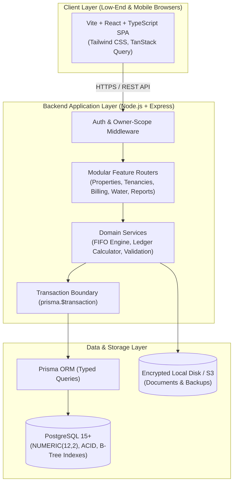
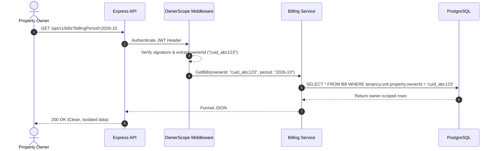

# System Architecture & Technical Rationale

**Document Version:** 2.0  
**Status:** Approved Architectural Baseline  

---

## 1. Architectural Philosophy: The Lean Monolith

The **Property Management System (PMS)** is intentionally designed as a **Lightweight Modular Monolith**. It avoids the operational complexity, distributed failure modes, and heavy runtime overhead of microservices, message brokers (Kafka/RabbitMQ), and distributed caches (Redis).

For an individual property owner or property management firm managing up to several hundred units across multiple properties, a cleanly architected Node.js/PostgreSQL system provides sub-50ms API response times while operating on low-cost single-node infrastructure ($5–$15/month).



---

## 2. Technology Stack Selection & Evaluation

| Layer | Selected Technology | Evaluated Alternatives | Rationale & Justification |
|---|---|---|---|
| **Frontend Framework** | **React 18 + Vite + TypeScript** | Next.js, Remix, Vue 3 | Vite SPA produces an ultra-small static bundle (~150 KB gzipped) that can be cached on any global CDN. Next.js was evaluated but rejected due to unnecessary Node server runtime memory overhead for this use case. |
| **Styling** | **Tailwind CSS** | Material UI, Ant Design, Chakra UI | Component libraries (MUI/AntD) introduce 300KB+ of JavaScript runtime overhead and complex CSS-in-JS emotion calculations. Tailwind generates static utility CSS with zero runtime overhead, critical for budget mobile devices. |
| **Backend Runtime** | **Node.js (LTS 20) + Express + TypeScript** | NestJS, Go, Python/FastAPI | Express provides the thinnest, most maintainable REST layer with negligible cold start times and minimal memory footprint (< 60 MB RAM). NestJS was rejected for excessive dependency injection abstraction; Go was rejected because sharing TypeScript models between client and server boosts single-developer velocity. |
| **ORM & Migrations** | **Prisma ORM** | TypeORM, Drizzle, Raw SQL | Prisma delivers compile-time end-to-end type safety, automated migration diff generation, and clean transaction syntax (`prisma.$transaction`). While Drizzle is slightly lighter, Prisma's mature migration engine and relation loading reduce developer error in complex financial joins. |
| **Database** | **PostgreSQL 15+** | MySQL, MongoDB, SQLite | PostgreSQL provides the industry benchmark for financial data integrity with exact `NUMERIC` types, table constraints, ACID transaction isolation, and advanced JSON/text indexing. SQLite was rejected due to concurrency write-locking constraints. |
| **Package Manager** | **pnpm** | npm, yarn, Turborepo | pnpm uses hard-links across workspaces, saving disk space and speeding up CI builds by 3x. Turborepo was evaluated but rejected as an unnecessary build abstraction for a straightforward two-app repo (`apps/web` and `apps/api`). |

---

## 3. Layering & Architectural Boundaries

```text
apps/
├── web/                           # Client SPA
│   ├── src/
│   │   ├── components/            # Reusable UI primitives (Buttons, Modals, Tables)
│   │   ├── features/              # Vertical slices (properties, billing, tenants)
│   │   ├── hooks/                 # Data queries & mutation hooks
│   │   └── lib/                   # API client, formatters, date/currency utils
└── api/                           # Server REST API
    ├── src/
    │   ├── middlewares/           # Auth validation, owner-scoping, error handler
    │   ├── modules/               # Vertical feature modules
    │   │   ├── auth/
    │   │   ├── properties/
    │   │   ├── tenancies/
    │   │   ├── billing/           # Charges, bills, water utilities
    │   │   ├── payments/          # FIFO allocation, receipts
    │   │   ├── reports/           # Financial summaries, CSV export
    │   │   └── documents/         # Secure file storage
    │   └── server.ts              # Express initialization
```

### 3.1 Strict Separation of Concerns
1. **No Business Logic in Controllers:** Controllers simply parse HTTP inputs, validate schema constraints with Zod, and delegate immediately to Domain Services.
2. **Domain Services are Pure & Testable:** The FIFO allocation engine, rent proration, and running ledger calculations are decoupled from HTTP request/response objects, enabling exhaustive unit testing without mocking web servers.
3. **Database Access via Services Only:** Routes never invoke raw Prisma queries directly. All queries pass through the domain service layer where owner scoping is strictly enforced.

---

## 4. Multi-Tenant Owner Isolation Architecture

The PMS employs a **Row-Level Shared Database Multi-Tenancy** model:



### Security Rules:
* The client NEVER sends `ownerId` in request payloads or query parameters.
* The API middleware extracts `ownerId` from the cryptographically verified JWT token or session.
* All Prisma queries include an explicit `where: { ownerId }` or relational check `where: { property: { ownerId } }`.
* Any attempt by an authenticated owner to access an ID belonging to another owner returns an immediate `404 Not Found` (to prevent ID enumeration) or `403 Forbidden`.

---

## 5. Lightweight Performance Principles

1. **Zero Runtime CSS Overhead:** Pure Tailwind CSS compiles at build time into an optimized ~15 KB stylesheet. No styled-components or Emotion runtime CSS parsing.
2. **Aggressive Browser Caching for Static Assets:** Vite hashes all bundle chunks. Index HTML is served with `Cache-Control: no-cache`, while static JavaScript/CSS are cached immutably for 1 year.
3. **Indexed Pagination:** Every list query (`GET /properties`, `GET /tenants`, `GET /bills`) enforces mandatory limit/offset pagination with indexed foreign keys to guarantee $O(\log N)$ database lookup speeds even as records scale past 10,000 charges.
4. **Lean Memory Footprint:** Node.js server configured with low base dependencies, consuming under 80 MB of resident memory under typical load.

---

## 6. Architecture Trade-Offs

| Decision | Benefits Chosen | Trade-Off Accepted |
|---|---|---|
| **Modular Monolith over Microservices** | Extreme simplicity, zero network latency between services, atomic database transactions, trivial local setup. | Requires disciplined module boundaries in the single codebase to avoid spaghetti coupling. |
| **PostgreSQL ACID Transactions over Eventual Consistency** | Guaranteed ledger accuracy, immediate balance updates, zero race conditions on unit double-booking. | Write throughput is bounded by single-database hardware capacity (more than adequate for thousands of properties). |
| **Client-Side Rendering (SPA) over SSR/Next.js** | Static hosting on cheap object storage/CDN, zero server rendering compute costs, offline navigation caching. | Slower initial HTML load than SSR (mitigated by sub-200KB bundle size); SEO is irrelevant for an authenticated private app. |
| **Local Disk Storage for Documents (MVP)** | Zero external AWS S3 dependencies or recurring cloud storage bills during early development. | Requires proper backup procedures for the `uploads/` folder alongside database dumps. S3 abstraction ready for post-MVP. |

