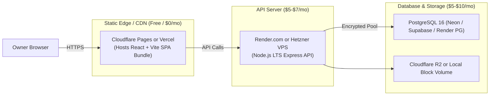

# Deployment, Infrastructure & Backup Operations

**Document Version:** 2.0  
**Scope:** Production Hosting, CI/CD Deployment, Backup Schedules, Disaster Recovery  

---

## 1. Environments Overview

| Environment | Purpose | Database | Base URL / Host |
|---|---|---|---|
| **Development** | Local developer workstation | Local PostgreSQL / Docker | `http://localhost:5173` (Web) / `http://localhost:5000` (API) |
| **Test** | Automated CI pipeline & local tests | Disposable PostgreSQL (`pms_test`) | Local ephemeral port |
| **Staging** | Pre-production testing & client demo | Managed PostgreSQL (Supabase / Render) | `https://staging.demo-pms.in` |
| **Production** | Live landlord operations | High-availability PostgreSQL | `https://app.demo-pms.in` |

---

## 2. Low-Cost Hosting Architecture & Operational Costs

To maintain the project priority of **simple, maintainable, and low-cost deployment**, the following lean infrastructure is recommended:



* **Estimated Total Operational Cost:** **$10 to $17 / month** total for hosting 100+ units across multiple landlords.

---

## 3. Build & Deployment Procedure

### 3.1 Build Commands
```bash
# Frontend Build (Vite)
pnpm --filter web build
# Generates static assets in apps/web/dist/

# Backend Build (TypeScript)
pnpm --filter api build
# Generates compiled Node.js commonjs/esm in apps/api/dist/
```

### 3.2 Production Deployment Sequence
1. **Pre-flight Checks:** Verify GitHub Actions CI has passed for formatting, linting, typechecks, and tests.
2. **Apply Database Migrations:**
   ```bash
   pnpm prisma migrate deploy --schema=database/schema.prisma
   ```
   *(Executes only pending migrations safely without dropping any data).*
3. **Deploy Backend API:**
   Zero-downtime rolling restart of the Node.js process (via PM2, Docker, or Render rolling deploys).
4. **Deploy Frontend SPA:**
   Deploy `apps/web/dist/` to CDN edge (Cloudflare Pages or Vercel).
5. **Post-Deployment Health Check:**
   `GET /api/v1/health` $\rightarrow$ Must return `200 OK` with database ping latency under 50ms.

---

## 4. Health Checks & Observability

### 4.1 Health Check Endpoint (`GET /api/v1/health`)
```json
{
  "status": "healthy",
  "version": "1.0.0",
  "timestamp": "2026-10-22T22:00:00.000Z",
  "database": {
    "status": "connected",
    "latencyMs": 8
  },
  "uptimeSeconds": 86400
}
```

### 4.2 Logging Standards
* Structured JSON logging in production (using Pino or Winston).
* Every log line includes `{ timestamp, level, requestId, ownerId?, path, statusCode, durationMs }`.
* Never log sensitive fields: password hashes, JWT secrets, full credit card numbers, or tenant identity documents.

---

## 5. Backup, Archival & Disaster Recovery (Module 10)

### 5.1 Automated Database Backup Schedule
* **Daily Full Dump:** Run every day at 02:00 IST via cron job or managed DB automated backup.
* **Format:** Compressed SQL dump (`pg_dump -Fc`).
* **Retention Policy:**
  * Daily backups retained for **30 days**.
  * Weekly backups retained for **12 weeks**.
  * Monthly backups retained for **7 years** (for tax and legal audit requirements).

### 5.2 Manual Backup Workflow (Via Admin UI)
Landlords can trigger an on-demand snapshot directly from the **Data Backup** screen:
1. Landlord clicks *Create Backup Now*.
2. API spawns a background worker executing:
   ```bash
   pg_dump -h $DB_HOST -U $DB_USER -d $DB_NAME -Fc -f /backups/pms_backup_20261022_manual.dump
   ```
3. System calculates the `SHA-256` checksum and creates a `BackupLog` record.
4. Landlord receives an immediate download link for offline storage.

### 5.3 Restore Verification Procedure
> [!IMPORTANT]
> A backup is unproven until a restore has been executed and verified in a separate environment.

Before production release, the following restore protocol must be tested:
1. Provision an empty test database: `createdb pms_restore_test`.
2. Restore the dump file:
   ```bash
   pg_restore -h localhost -U pms_user -d pms_restore_test -v /backups/pms_backup_sample.dump
   ```
3. Run automated verification script to verify:
   * Total row counts for `Owner`, `Property`, `Unit`, `Tenant`, `Bill`, `Charge`, and `Payment` match source counts.
   * Total sum of `Payment.amount` matches source ledger.
4. Drop the test database after verification: `dropdb pms_restore_test`.

---

## 6. Rollback & Incident Recovery

* **Code Rollback:** Roll back to the previous Git commit hash or previous frontend CDN deployment within 60 seconds.
* **Database Rollback:** If a newly applied migration causes unexpected application errors, apply a dedicated forward rollback migration rather than running destructive down migrations on live data.

