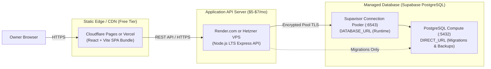

# Deployment, Infrastructure & Backup Operations (Supabase PostgreSQL)

**Document Version:** 2.1  
**Database Provider:** Supabase Managed PostgreSQL  
**Scope:** Hosting Topology, Environment Isolation, Supabase Plan Verification, Migration Pipelines, Backup & Disaster Recovery  

---

## 1. Environments Overview & Project Isolation

To prevent test runs or feature development from corrupting live tenant records or financial ledgers, environments must remain strictly isolated:

| Environment | Purpose | Database Strategy | Base URL / Host |
|---|---|---|---|
| **Development** | Local developer workstation | Shared Supabase Dev Project (`pms-dev`) OR Local Docker | `http://localhost:5173` (Web) / `http://localhost:5000` (API) |
| **Test** | Automated CI pipeline & local tests | Isolated database (`pms_test`) on local/ephemeral PostgreSQL | Ephemeral test port |
| **Staging** | Pre-production testing & client demo | Dedicated Supabase Staging Project (`pms-staging`) | `https://staging.demo-pms.in` |
| **Production** | Live landlord operations | Dedicated Supabase Production Project (`pms-prod`) | `https://app.demo-pms.in` |

> [!IMPORTANT]
> **Environment Separation Rule:**
> NEVER point development or staging environments to the production Supabase project. Each environment must have its own distinct Supabase project reference and database password.

---

## 2. Hosting Topology & Operational Cost Analysis



### Estimated Operational Costs:
* **Frontend CDN:** Free (Cloudflare Pages or Vercel Free tier).
* **API Server:** $5 – $7 / month (Render.com Web Service or small VPS).
* **Supabase Database:**
  * *Development / Staging:* $0 / month (Supabase Free Tier).
  * *Production:* Free or $25 / month (Supabase Pro Tier, depending on backup, SLA, and compute requirements).
* **Total Estimated Hosting Cost:** **$5 to $32 / month** for 100+ units across multiple landlords.

---

## 3. Supabase Plan Capabilities & Operational Trade-Offs

Before selecting a plan for production client deployments, the engineering team must review current specifications at [supabase.com/pricing](https://supabase.com/pricing).

> [!WARNING]
> **Supabase Free Tier Limitations:**
> * **Project Auto-Pausing:** Free tier projects are automatically paused after **7 days of inactivity**. While unpausing is free, unpausing takes several minutes, resulting in temporary service downtime.
> * **No Automated Restore / PITR:** Point-in-Time Recovery (PITR) and automated daily backup restoration are **NOT** available on the Free plan.
> * **Connection Limits:** Restricted to ~15 direct connections and ~200 pooled connections.
> * **Compute Resources:** Shared micro-instances with limited memory and burstable CPU.

### Production Recommendation:
For commercial landlord operations handling real money and legal tenancies, **Supabase Pro Tier ($25/mo)** is recommended for production because:
1. No auto-pausing (guaranteed continuous availability).
2. Daily automated backups with 7-day retention included.
3. Option to enable Point-in-Time Recovery (PITR) for minute-by-minute rollback protection.
4. Higher connection pool limits and configurable dedicated compute.

---

## 4. Build & Deployment Procedure

### 4.1 Build Commands
```bash
# Frontend Build (Vite)
pnpm --filter web build
# Output: apps/web/dist/

# Backend Build (TypeScript)
pnpm --filter api build
# Output: apps/api/dist/
```

### 4.2 Production Deployment Sequence
1. **Pre-flight Checks:** Verify GitHub Actions CI has passed for formatting, linting, typechecking, and tests.
2. **Execute Database Migrations:**
   ```bash
   pnpm prisma migrate deploy --schema=database/schema.prisma
   ```
   *Note: Prisma reads `DIRECT_URL` (port 5432) from the environment to run DDL operations against Supabase.*
3. **Deploy Backend API:** Rolling zero-downtime deployment of the Node.js Express service.
4. **Deploy Frontend SPA:** Upload `apps/web/dist/` to Cloudflare Pages or Vercel.
5. **Post-Deployment Health Check:**
   `GET /api/v1/health` $\rightarrow$ Verifies database connectivity and latency.

---

## 5. Independent Database Backups & Restore Verification (Module 10)

Because cloud providers can experience platform-wide outages or account issues, the PMS must never rely solely on Supabase managed backups. An independent, off-site backup strategy is mandatory.

### 5.1 Automated Independent Backup Procedure
* **Tool:** `pg_dump` executed via automated cron job or GitHub Actions scheduled workflow.
* **Connection:** Uses `DIRECT_URL` with SSL enabled (`sslmode=require`).
* **Command:**
  ```bash
  pg_dump "$DIRECT_URL" -Fc -Z 9 -f "./backups/pms_backup_$(date +%Y%m%d_%H%M%S).dump"
  ```
* **Checksum Verification:** System computes the SHA-256 hash of the generated `.dump` file and logs the event to the `BackupLog` table.
* **Off-Site Transfer:** Encrypted backup dump is copied to private cloud storage (AWS S3 or Cloudflare R2) with a 30-day retention policy.

### 5.2 Documented Restore Procedure
To restore a backup into a new or recovery database:
1. Provision a target database or create an isolated verification database:
   ```bash
   createdb -h localhost -U pms_user pms_restore_test
   ```
2. Execute the restore using `pg_restore`:
   ```bash
   pg_restore -h localhost -U pms_user -d pms_restore_test -v --clean --no-owner --no-privileges "./backups/pms_backup_sample.dump"
   ```
3. Run post-restore verification queries:
   ```sql
   -- Verify core entity counts match
   SELECT 'Owners' AS entity, COUNT(*) FROM "Owner"
   UNION ALL
   SELECT 'Properties', COUNT(*) FROM "Property"
   UNION ALL
   SELECT 'Units', COUNT(*) FROM "Unit"
   UNION ALL
   SELECT 'Bills', COUNT(*) FROM "Bill"
   UNION ALL
   SELECT 'Payments', COUNT(*) FROM "Payment";
   
   -- Verify total allocated financial sum matches
   SELECT SUM("amount") AS total_allocations FROM "PaymentAllocation";
   ```
4. Clean up the verification database: `dropdb -h localhost -U pms_user pms_restore_test`.

### 5.3 Periodic Restore Testing Gate
Every quarter, a senior engineer must execute a dry-run restore into a non-production environment and record the verification timestamp in the operational log.

---

## 6. Connection Pooling, Monitoring & Scaling

* **Monitor Connection Usage:** Regularly review connection graphs in the Supabase Dashboard under **Reports $\rightarrow$ Database** to ensure peak traffic remains below 70% of available pool capacity.
* **Pooler Sizing:** When using Supavisor (port 6543), set `connection_limit` in the Express Prisma Client pool to prevent individual server instances from hoarding pooler slots.
* **Data Privacy & Encryption:**
  * In-transit: Encrypted via TLS 1.3 (`sslmode=require`).
  * At-rest: Supabase encrypts all disk volumes using AES-256 at the cloud hypervisor level.
  * Personal Data Hygiene: Tenant Aadhaar, PAN, and identity proofs are access-controlled via owner-scoped endpoints and never cached unencrypted.
