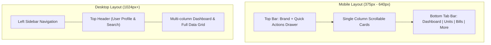

# UI/UX Design System & Mobile Responsiveness Guidelines

**Document Version:** 2.0  
**Framework:** Tailwind CSS (No heavy runtime component libraries)  
**Target Viewports:** Mobile (375px–640px), Tablet (641px–1024px), Desktop (1025px+)  

---

## 1. Responsive Layout & Navigation Architecture

Landlords manage properties on the go from smartphones, inspect units with tablets, and perform accounting reconciliations on desktop workstations. The design system prioritizes high readability, touch-target ergonomics, and fast page loads on low-end mobile devices.

### 1.1 Viewport Breakpoints & Navigation Layouts

| Device | Viewport Width | Navigation Pattern | Layout Strategy |
|---|---|---|---|
| **Mobile** | `375px` to `640px` | Bottom Navigation Bar (4 primary tabs) + Top "Hamburger" Drawer for secondary tools | Single-column stacked cards. Tables transform into swipeable/collapsible cards. |
| **Tablet** | `641px` to `1024px` | Collapsible Slim Icon Sidebar | 2-column grid for KPIs and property summaries. Standard data tables with horizontal scroll indicators. |
| **Desktop** | `1025px+` | Fixed Left Sidebar (Expanded with labels) | 3-to-4 column metric grid, full financial data tables with inline filters. |



---

## 2. Color Palette & Semantic Tokens

The design uses a clean, professional financial palette with high contrast ratios (WCAG AA compliant):

* **Primary (Trust & Clarity):** Slate / Deep Indigo
  * `primary-600`: `#4f46e5` (Buttons, active tabs, links)
  * `primary-700`: `#4338ca` (Hover state)
  * `primary-50`: `#eef2ff` (Active backgrounds)
* **Neutral (Surfaces & Text):**
  * `neutral-900`: `#0f172a` (Primary headings & body text)
  * `neutral-600`: `#475569` (Secondary labels & metadata)
  * `neutral-100`: `#f1f5f9` (Card borders & dividers)
  * `neutral-50`: `#f8fafc` (Page background)
* **Financial Semantic Colors:**
  * **Success (Paid / Available):** Emerald (`bg-emerald-50`, `text-emerald-700`, `border-emerald-200`)
  * **Warning (Partially Paid / Expiring):** Amber (`bg-amber-50`, `text-amber-700`, `border-amber-200`)
  * **Danger (Overdue / Defaulter / Error):** Rose (`bg-rose-50`, `text-rose-700`, `border-rose-200`)
  * **Info (Occupied / Draft):** Sky (`bg-sky-50`, `text-sky-700`, `border-sky-200`)

---

## 3. Typography & Financial Data Formatting

* **Font Stack:** Inter, system-ui, -apple-system, sans-serif (Clean sans-serif with excellent number legibility).
* **Currency Formatting:**
  * Always use the tabular number utility (`font-mono` or `tabular-nums`) for monetary values so decimal columns align vertically:
  * Example: `<span className="font-mono tabular-nums font-semibold">₹18,500.00</span>`
* **Hierarchy:**
  * H1 (Page Title): `text-2xl font-bold text-neutral-900`
  * H2 (Section Header): `text-lg font-semibold text-neutral-800`
  * Metric KPI Value: `text-3xl font-extrabold text-neutral-900 tracking-tight`
  * Body Text: `text-sm text-neutral-600 leading-normal`
  * Table Header: `text-xs font-semibold text-neutral-500 uppercase tracking-wider`

---

## 4. UI Components & Patterns

### 4.1 Buttons & Touch Targets
* All clickable elements on mobile must have a minimum touch target of **44 × 44 pixels**.
* Primary Button: `h-10 px-4 py-2 bg-primary-600 text-white rounded-lg font-medium hover:bg-primary-700 active:scale-95 transition`
* Secondary Button: `h-10 px-4 py-2 bg-white text-neutral-700 border border-neutral-300 rounded-lg hover:bg-neutral-50`

### 4.2 Mobile-Friendly Financial Tables
On small mobile screens (`< 640px`), standard multi-column tables become illegible. The PMS implements a dual-mode pattern:
* **Desktop (`md:table`):** Traditional data table with columns: *Unit*, *Tenant*, *Due Date*, *Amount*, *Paid*, *Balance*, *Status*, *Actions*.
* **Mobile (`md:hidden`):** Compact card list:
  ```html
  <div class="p-4 bg-white rounded-lg border border-neutral-200 shadow-sm space-y-2">
    <div class="flex justify-between items-start">
      <div>
        <h4 class="font-semibold text-neutral-900">Flat 101 — Priya Nair</h4>
        <p class="text-xs text-neutral-500">Period: 2026-10 | Due: 05 Nov</p>
      </div>
      <span class="px-2 py-0.5 text-xs rounded-full bg-rose-50 text-rose-700 font-medium">OVERDUE</span>
    </div>
    <div class="flex justify-between items-baseline pt-2 border-t border-neutral-100">
      <span class="text-xs text-neutral-500">Balance Due:</span>
      <span class="text-lg font-bold font-mono text-rose-600">₹18,500.00</span>
    </div>
  </div>
  ```

### 4.3 Standard Status Badges
Consistent pill badges across all modules:
* `AVAILABLE`: `bg-emerald-50 text-emerald-700 ring-1 ring-emerald-600/20`
* `OCCUPIED`: `bg-sky-50 text-sky-700 ring-1 ring-sky-600/20`
* `MAINTENANCE`: `bg-amber-50 text-amber-700 ring-1 ring-amber-600/20`
* `OVERDUE`: `bg-rose-50 text-rose-700 ring-1 ring-rose-600/20`
* `PAID`: `bg-emerald-50 text-emerald-700 ring-1 ring-emerald-600/20`

---

## 5. State Handling: Empty, Loading, and Error States

Every screen and list must explicitly support 4 fundamental states:
1. **Loading State:** Subtle skeleton shimmer components matching the shape of the expected cards/tables (avoid full-screen blocking spinners).
2. **Empty State:** Friendly graphic/icon with clear instructional text and a call-to-action button (e.g. *"No units found. Add your first rental unit to begin"*).
3. **Error State:** Clear error description with an immediate *Retry* button and troubleshooting hints.
4. **Success / Confirmation State:** Toast notifications confirming action execution (e.g. *"Payment of ₹15,000 recorded. Receipt #REC-2026-0042 generated"*).

---

## 6. Accessibility & Keyboard Navigation (a11y)

* **Keyboard Operable:** All forms, modals, and actions must be reachable via `Tab` and executable via `Enter` or `Space`.
* **Visible Focus:** Focus rings enabled on all interactive elements: `focus:outline-none focus:ring-2 focus:ring-primary-500 focus:ring-offset-2`.
* **Form Labels:** Every `<input>` must have a semantic `<label>` element with an explicit `htmlFor` binding; never rely on placeholders alone.
* **Color Contrast:** Text-to-background contrast ratio meets or exceeds **4.5:1** for standard body text.

