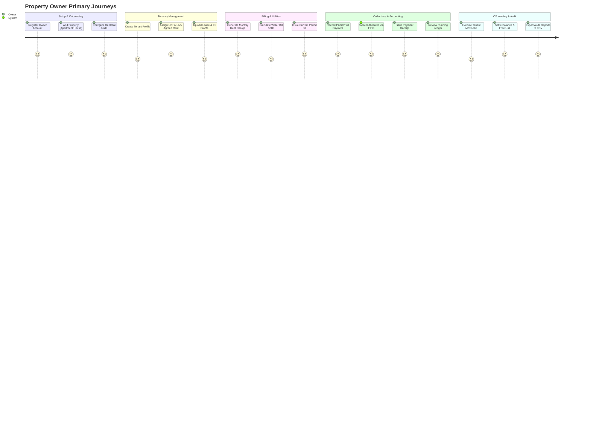
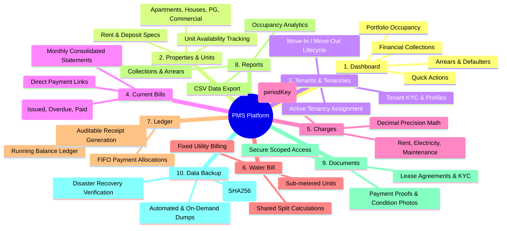

# Property Management System (PMS) — Software Requirements Specification (SRS)

**Document Version:** 2.0  
**Status:** Approved Master Specification  
**Default Currency:** Indian Rupee (INR / ₹)  
**Target Audience:** Property Owners, Landlords, Property Managers, Engineering Team  

---

## 1. Executive Summary & Business Goals

### 1.1 Business Problem
Individual landlords and property owners managing diverse portfolios (residential apartments, independent houses/villas, commercial shops, and PG units exceeding 100 total units) currently rely on fragmented tools: paper receipt books, Excel spreadsheets, unstructured WhatsApp messages, and manual bank record reconciliations.

This creates critical operational risks:
* **Revenue Leakage:** Missed utility collections (water/electricity), forgotten rent adjustments, and uncollected late dues.
* **Accounting Errors:** Human calculation mistakes in partial rent payments, security deposits, and multi-tenant water splitting.
* **Audit & Legal Blindspots:** Loss of tenant move-in/move-out records, lack of formal rent payment receipts, and missing lease documents.
* **Inefficient Management:** Time wasted hunting for tenant contact details, payment proofs, and outstanding balances.

### 1.2 Solution Vision
The **Property Management System (PMS)** is a lightweight, responsive, secure web platform providing individual property owners with a single dashboard to manage properties, units, tenants, billing, payments, ledgers, documents, and system backups across desktop, tablet, and mobile browsers.

---

## 2. User Roles & Primary User Journeys

### 2.1 User Roles
* **Owner / Landlord (Primary User):** Registers, authenticates, owns all tenant/property data, issues bills, logs payments, views ledgers, generates reports, uploads documents, and executes backups.
* **Tenant (Future / Secondary):** In future phases, tenants may view read-only bills and ledgers via secure links. For the MVP, the Owner performs all management actions.
* **System / Automation:** Scheduled tasks executing monthly recurring bill generation and automated database backups.

### 2.2 Primary User Journeys

---

## 3. Scope of All Ten Core Modules

### Module 1: Dashboard
* Real-time metrics computed directly from database aggregates.
* **KPI Cards:** Total Properties, Total Units, Occupancy Rate (%), Rent Billed this Month, Total Collections this Month, Outstanding Overdue Arrears.
* **Defaulters Alert:** Quick glance at tenants with unpaid bills older than the due date.
* **Quick Actions:** Single-click shortcuts to *Add Unit*, *Assign Tenant*, *Record Payment*, *Add Meter Reading*.

### Module 2: Properties & Units / Houses
* Multi-property taxonomy: Residential Apartment Buildings, Independent Houses/Villas, Commercial complexes, and PG/Hostels.
* Hierarchy: One Owner $\rightarrow$ Multiple Properties $\rightarrow$ Multiple Units.
* Unit attributes: Unit/Flat Number, Floor, Bedroom/Bathroom configuration, Base Monthly Rent, Security Deposit requirement, Water Sub-meter ID, Status (`AVAILABLE`, `OCCUPIED`, `MAINTENANCE`, `ARCHIVED`).
* Validation: Unit numbers must be unique within a property.

### Module 3: Tenants & Tenancies
* Tenant directory with contact information, emergency phone, Aadhaar/PAN ID metadata, and general notes.
* Tenancy contracts binding a Tenant to a Unit:
  * Effective `moveInDate`, optional `moveOutDate`, agreed monthly rent snapshot, security deposit tracked (`depositPaid`, `depositReturned`).
  * Invariant: A unit cannot have more than one `ACTIVE` tenancy simultaneously.
  * Move-out workflow: Setting `moveOutDate` flips Tenancy to `ENDED` and returns the Unit status to `AVAILABLE` without deleting past financial records.

### Module 4: Current Bills
* Generates a monthly consolidated bill per active tenancy for a given billing period (e.g., `2026-10`).
* Combines Rent, Electricity, Water Bill, Maintenance, and Late Fees into a single itemized invoice with a unique bill number (`BILL-YYYYMM-XXX`).
* Tracks bill payment lifecycle: `DRAFT` $\rightarrow$ `ISSUED` $\rightarrow$ `PARTIALLY_PAID` $\rightarrow$ `PAID` $\rightarrow$ `OVERDUE`.

### Module 5: Charges
* Atomic debit items tied to a tenancy.
* Types: `RENT`, `WATER`, `ELECTRICITY`, `MAINTENANCE`, `LATE_FEE`, `SECURITY_DEPOSIT`, `OTHER`.
* Duplicate prevention: Each charge maintains a `periodKey` unique per tenancy (e.g. `tenancyId + "_" + "2026-10-RENT"`), preventing accidental double-billing.
* Monetary values stored using PostgreSQL `NUMERIC(12, 2)`.

### Module 6: Water Bill
* Specialized utility module supporting diverse landlord water billing practices:
  1. **Metered Reading:** `(Current Reading - Previous Reading) * Rate Per Unit`.
  2. **Equal Split:** Total property water bill divided equally by the number of occupied units.
  3. **Occupant-Weighted Split:** Divided based on registered tenant occupants.
  4. **Fixed Monthly Charge:** Standard recurring water fee.
* Automatically creates/links an itemized `Charge` record directly into the tenant's Current Bill.

### Module 7: Ledger & Payment Allocation
* Immutable running statement of account for each tenant/tenancy.
* Chronological view: Date, Description, Debit (Charges), Credit (Payments), and Running Balance.
* **FIFO Payment Allocation:** When a payment is recorded, the engine automatically allocates funds to the oldest unpaid charges first.
* Handles partial payments seamlessly (marking charges `PARTIALLY_PAID`).
* Digital printable receipt generation with receipt numbers (`REC-YYYY-XXXX`).

### Module 8: Reports & Analytics
* **Monthly Collection Report:** Total billed vs total collected per month across properties.
* **Outstanding Dues & Defaulters Report:** Itemized list of unpaid charges, aging brackets (1-30 days, 30-60 days, 60+ days).
* **Occupancy Report:** Unit occupancy percentage, vacancy durations, and turnover rates.
* **CSV Export:** All reports downloadable in RFC 4180-compliant CSV for offline accounting and tax preparation.

### Module 9: Documents
* Secure file management for legal, tenant, and property records.
* Categories: `LEASE_AGREEMENT`, `TENANT_ID_PROOF`, `UTILITY_BILL`, `PAYMENT_RECEIPT`, `PROPERTY_TAX_DEED`, `INSPECTION_REPORT`.
* Metadata tracking: File title, MIME type, file size, upload timestamp, and entity tags (Property, Unit, Tenant, Tenancy).
* Strictly protected: Files are served only through owner-authenticated endpoints.

### Module 10: Data Backup
* Operational safety net for landlord data.
* Capability to trigger on-demand backups or automated database dumps.
* Backup manifest recording file size, timestamp, completion status, and SHA-256 integrity checksums.
* Downloadable archive for local landlord archiving.

---

## 4. MVP Inclusions vs. Exclusions

### 4.1 In Scope (MVP Base)
* Complete owner authentication and session isolation.
* Full CRUD for Properties, Units, Tenants, and Tenancies.
* Tenancy assignment with concurrency validation (no double-booking).
* Generation of monthly rent and utility charges with duplicate-prevention constraints.
* Water bill calculation (metered readings and equal splits).
* Payment recording (Cash, UPI, Bank Transfer) with FIFO allocation and partial payment support.
* Tenant running ledger and printable HTML receipts.
* Executive dashboard and downloadable CSV reports.
* Document upload and secure download for agreements and KYC.
* On-demand database backup creation and export.
* Fully responsive layout (Mobile 375px+, Tablet 768px, Desktop 1280px+).

### 4.2 Out of Scope (Deferred to Post-MVP)
* Automated third-party payment gateway integration (Razorpay, Stripe) — MVP records manual receipts.
* Direct SMS / WhatsApp API gateway integrations (landlords can share receipts manually or via mail).
* Complex multi-user role hierarchies (e.g., property managers, maintenance technicians with restricted permissions).
* Tenant self-service portal login (tenants view statements via exported PDFs/receipt links).
* Bed-level hostel allocation workflows.

---

## 5. Non-Functional Requirements (NFRs)

### 5.1 Performance & Low-End Device Optimization
* **Initial Page Load:** Under 1.5 seconds on 4G connections.
* **Frontend Bundle:** Gzipped JavaScript bundle size under 200 KB.
* **Lightweight UI:** No heavy animation libraries or bloated component frameworks. Fast rendering on budget smartphones and tablets.
* **Database Performance:** Proper compound indexes on `ownerId`, `dueDate`, `status`, and `billingPeriod`. Pagination on all list queries.

### 5.2 Security & Data Boundary
* 100% server-side authorization enforcement: every query must include `ownerId` derived from the verified session.
* Modern cryptographic hashing for passwords (bcrypt cost factor 12+ or Argon2id).
* Rate limiting on authentication routes (maximum 5 failed attempts per 15 minutes per IP).
* Uploaded documents stored with sanitized filenames outside the public web root.

### 5.3 Reliability & Financial Correctness
* Database transactions (`prisma.$transaction`) wrapping all multi-record financial mutations.
* Zero floating-point arithmetic on currency values.
* Absolute audit retention: soft-deletions on all properties and tenants with financial history.

---

## 6. Business Rules & Financial Invariants

1. **Active Occupancy Rule:** A unit can have at most one tenancy with `status = 'ACTIVE'`. Any attempt to assign an active tenancy to an already occupied unit must be rejected by the API.
2. **Billing Idempotency Rule:** A tenancy cannot have more than one charge with the same `periodKey`. Rent generation batch processes must be strictly idempotent.
3. **Monetary Storage & Arithmetic:**
   * All currency fields use `Decimal(12, 2)` (up to ₹9,999,999,999.99 with exact 2 decimal paise precision).
   * Calculations must use decimal arithmetic libraries (`decimal.js` or integer paise).
4. **Running Balance Invariant:**
   $$\text{Outstanding Balance} = \sum \text{Charges (OPEN / PARTIALLY\_PAID)} - \sum \text{Allocations}$$
5. **FIFO Payment Allocation Rule:**
   * Payments are applied sequentially to the oldest unpaid charges by `dueDate ASC`.
   * If payment exceeds total open charges, the excess is retained as unallocated credit balance for future billing periods.
6. **Move-Out Historical Immutability:**
   * Moving a tenant out (`TenancyStatus.ENDED`) does not delete or alter any previously generated charges, payments, bills, or receipts.

---

## 7. Confirmed Requirements vs. Unresolved Decisions

### 7.1 Confirmed Requirements
* **Platform Architecture:** Client-server web app accessible via mobile/tablet/desktop browsers.
* **Default Currency:** Indian Rupee (`INR` / `₹`).
* **Tenant Assignment:** Single-unit active occupancy enforcement.
* **Receipts:** Sequential numbering (`REC-YYYY-XXXX`) generated for every payment.
* **Audit Trail:** Soft archival via `archivedAt` flags; cascading deletes strictly disabled on financial entities.

### 7.2 Unresolved Decisions (Client Approvals Required)
* **Rent Proration Policy:** If a tenant moves in on the 10th of a 30-day month, does the system bill exact daily proration $\frac{\text{Rent}}{30} \times 20$, or standard full-month billing? *(Recommendation: Daily proration)*.
* **Water Bill Split Strategy:** Default rule for buildings with a single master meter: equal split across units or weighted by registered occupant count? *(Recommendation: Equal split per active unit)*.
* **Overpayment Handling:** Should excess payment amounts be rejected at input, or automatically stored as account credit applied to the next billing cycle? *(Recommendation: Store as account credit)*.
* **Late Fee Automation:** Should late fees be applied automatically when `currentDate > dueDate`, or manually added by the landlord? *(Recommendation: Manual landlord confirmation for MVP)*.
