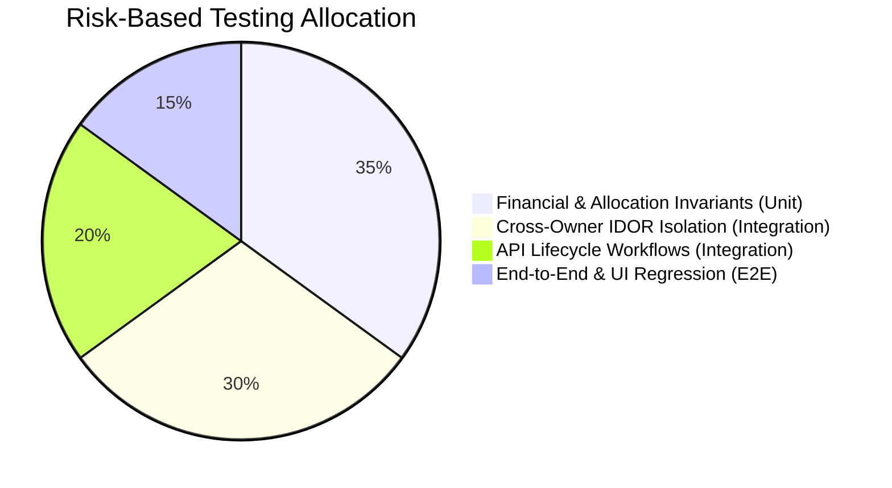

# Quality Assurance & Testing Strategy

**Document Version:** 2.0  
**Test Frameworks:** Vitest / Jest (Unit & Integration), Supertest (REST API), Playwright (End-to-End)  
**Database Isolation:** Dedicated `pms_test` database (Truncated between test suites)  

---

## 1. Testing Pyramid & Risk-Based Coverage

Because the PMS handles real money, tenant legal agreements, and landlord balances, testing priorities are aligned directly with risk:



### Coverage Expectations
* **Financial Calculations (FIFO, Proration, Balances):** **100%** branch coverage required.
* **Owner-Scoped Data Access Middleware:** **100%** route coverage required.
* **Standard CRUD Routes:** **80%+** line coverage.
* **UI Components:** Critical workflows covered via E2E; static presentation verified visually across responsive breakpoints.

---

## 2. Test Suites Breakdown

### 2.1 Unit Tests (Pure Domain Logic)
* **Location:** `apps/api/src/modules/**/__tests__/*.spec.ts`
* **Characteristics:** Sub-millisecond execution, zero database or network dependencies.
* **Key Targets:**
  * **FIFO Allocation Engine:** Verify that a payment of ₹15,000 against charges of ₹10,000 (Aug) and ₹10,000 (Sep) fully satisfies Aug, marks Sep as `PARTIALLY_PAID` with ₹5,000 remaining, and leaves ₹0 unallocated.
  * **Decimal Rounding:** Verify arithmetic precision with 2 decimal places without binary float drift.
  * **Proration Calculator:** Verify calendar-day rent calculations when move-in occurs mid-month.
  * **Idempotency Key Generator:** Verify duplicate rejection.

### 2.2 Integration Tests (API & Database Layer)
* **Location:** `apps/api/test/integration/*.test.ts`
* **Characteristics:** Executes against a real, isolated PostgreSQL test database (`pms_test`).
* **Key Targets:**
  * **Cross-Owner Authorization Tests:**
    * Create Owner A and Owner B.
    * Seed Owner A with property, unit, tenant, and bill.
    * Request all endpoints using Owner B's JWT $\rightarrow$ Verify that all attempts to inspect, modify, or delete Owner A's records return `404 Not Found` or `403 Forbidden`.
  * **Tenancy Overlap Concurrency:**
    * Attempt to assign Tenant 2 to Unit 1 while Tenant 1's tenancy is `ACTIVE`.
    * Verify database constraint / transaction rejects with `409 Conflict`.
  * **Payment & Bill Reconciliation:**
    * Create a bill with rent (₹10,000) and water (₹500).
    * Submit payment of ₹10,500.
    * Verify bill status transitions to `PAID`, charge statuses update to `PAID`, and tenant ledger balance equals `₹0.00`.

### 2.3 End-to-End (E2E) Acceptance Tests
* **Framework:** Playwright
* **Location:** `apps/web/e2e/*.spec.ts`
* **Key Scenarios:**
  1. *Complete Onboarding:* Register $\rightarrow$ Add Property $\rightarrow$ Add Unit $\rightarrow$ Add Tenant $\rightarrow$ Assign Tenancy.
  2. *Monthly Billing Cycle:* Generate monthly bills $\rightarrow$ Record UPI payment $\rightarrow$ View/print generated receipt.
  3. *Tenant Move-Out:* Move out tenant $\rightarrow$ Verify unit shows `AVAILABLE` $\rightarrow$ Confirm historical invoices remain accessible.
  4. *Mobile Viewport Navigation:* Execute payment recording on mobile viewport (375 × 667).

---

## 3. Test Database Isolation & Environment Setup

### 3.1 Database Isolation Procedure
1. Tests run with `NODE_ENV=test` and `DATABASE_URL` pointing to `DATABASE_TEST_URL`.
2. Before all suites execute:
   ```bash
   pnpm prisma migrate deploy --schema=database/schema.prisma
   ```
3. A global test hook truncates all tables between test files in reverse dependency order:
   ```typescript
   // apps/api/test/setup.ts
   afterEach(async () => {
     await prisma.$executeRawUnsafe(`
       TRUNCATE TABLE "PaymentAllocation", "Charge", "WaterBill", 
       "Bill", "Payment", "Tenancy", "Unit", "Tenant", 
       "Property", "Owner" CASCADE;
     `);
   });
   ```

---

## 4. Quality Gates for Phase Completion

No development phase is considered complete until it passes the following gates:

| Phase | Mandatory Testing Gate |
|---|---|
| **Phase 1: Setup** | Zero lint errors, Prettier check passes, TypeScript compiles cleanly. |
| **Phase 2: DB & Auth** | Registration, login, JWT validation, and 100% of cross-owner IDOR test cases pass. |
| **Phase 3: Properties & Units** | Unit CRUD verified, overlapping tenancy prevention test passes under concurrent attempts. |
| **Phase 4: Billing & Payments** | FIFO payment allocation, water bill split formulas, and partial payment math achieve 100% unit test coverage. |
| **Phase 5: Ledger & Dashboard** | Ledger running balance reconciles against raw sum of charges minus allocations. |
| **Phase 6: Reports & Backups** | CSV export generated cleanly; database backup dumped and verified via SHA-256 restore in test environment. |
| **Phase 7: UI & Responsiveness** | Verified across Mobile (375px), Tablet (768px), and Desktop (1280px) with zero layout breaking. |
| **Phase 8: Release Rehearsal** | Full end-to-end acceptance checklist executed in staging environment. |

