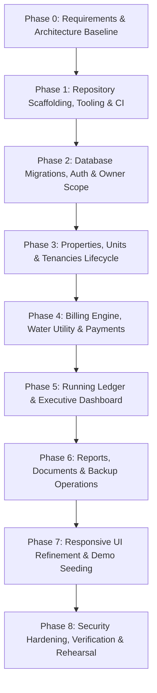

# Master Development Plan: 9-Phase Implementation Roadmap

**Document Version:** 2.0  
**Status:** Approved Master Implementation Plan  
**Target Architecture:** Lightweight Node.js/Express + React/Vite TypeScript Monorepo  

---

## 1. Roadmap Overview & Dependency Graph

---

## 2. Phase-by-Phase Execution Specifications

### Phase 0: Requirements, Open Questions & Architecture Approval
* **Scope:** Audit workspace, establish foundational documentation, design relational schema with PostgreSQL/Prisma, define financial invariants, and map unresolved client decisions.
* **Dependencies:** None.
* **Deliverables:**
  * Complete documentation suite (`README.md`, `SRS.md`, `ARCHITECTURE.md`, `SECURITY.md`, `TESTING_STRATEGY.md`, etc.).
  * Updated Prisma schema supporting all 10 modules.
  * Root workspace files (`pnpm-workspace.yaml`, `.env.example`, `.gitignore`).
* **Testing Gate:** Documentation cross-reference verification and schema syntax validation.
* **Status:** **COMPLETE (Current Baseline)**.

---

### Phase 1: Repository Conventions, Tooling, Typechecking & CI
* **Scope:** Scaffold `apps/web` (Vite + React + Tailwind) and `apps/api` (Express + TypeScript). Configure ESLint, Prettier, TypeScript strict configs, and wire up GitHub Actions CI.
* **Dependencies:** Phase 0.
* **Implementation Order:**
  1. Initialize `apps/api` with Express, TypeScript, and basic healthcheck route (`/api/v1/health`).
  2. Initialize `apps/web` with Vite, React 18, TypeScript, and Tailwind CSS.
  3. Configure root ESLint and Prettier configs.
  4. Activate CI pipeline in `.github/workflows/ci.yml`.
* **Testing Gate:**
  * `pnpm format:check` passes without errors.
  * `pnpm lint` passes with zero warnings.
  * `pnpm typecheck` compiles clean across both apps.
  * GitHub Actions CI passes on pull request.

---

### Phase 2: Database Schema, Migrations, Authentication & Owner Isolation
* **Scope:** Apply PostgreSQL Prisma migrations in a development database, build owner registration, login, JWT token issuance, and implement the authoritative `ownerScope` middleware.
* **Dependencies:** Phase 1.
* **Implementation Order:**
  1. Generate initial Prisma migration: `prisma migrate dev --name init_pms_schema`.
  2. Implement password hashing using `bcryptjs` (cost factor 12).
  3. Implement `/api/v1/auth/register`, `/api/v1/auth/login`, and `/api/v1/auth/me`.
  4. Implement `requireAuth` and `ownerScope` middleware.
  5. Build automated cross-owner IDOR test suite.
* **Testing Gate:**
  * 100% of authentication unit and integration tests pass.
  * Cross-owner test explicitly verifies that Owner B cannot view or modify Owner A's records.

---

### Phase 3: Properties, Units, Tenants & Tenancy Lifecycle
* **Scope:** Full CRUD endpoints and responsive UI for Properties (Apartments, Houses, Commercial), Units, and Tenants. Implement tenancy assignment and move-out settlement.
* **Dependencies:** Phase 2.
* **Implementation Order:**
  1. Implement Properties API & UI screens.
  2. Implement Units API & UI screens with property-unique unit constraints.
  3. Implement Tenant directory API & KYC forms.
  4. Implement Tenancy Assignment workflow:
     * Check unit availability.
     * Atomically create `Tenancy` and set `Unit.status = 'OCCUPIED'`.
  5. Implement Move-Out workflow:
     * Update `Tenancy.status = 'ENDED'`.
     * Reset `Unit.status = 'AVAILABLE'`.
     * Preserve all historical records.
* **Testing Gate:**
  * Unit test verifies overlapping tenancy prevention under concurrent attempts.
  * Move-out test confirms unit is freed without altering past tenancy history.

---

### Phase 4: Charges, Current Bills, Water Bills, Payments & Allocations
* **Scope:** The core financial engine. Monthly billing generator, water sub-metering / split calculators, payment recording, and FIFO payment allocation.
* **Dependencies:** Phase 3.
* **Implementation Order:**
  1. Implement `Charge` creation service with `periodKey` duplicate prevention.
  2. Implement `Bill` consolidation service (Current Bills module).
  3. Implement `WaterBill` module:
     * Metered consumption calculation (`(current - previous) * rate`).
     * Equal-split calculation across occupied units.
  4. Implement `Payment` recording with sequential receipt numbering (`REC-YYYY-XXXX`).
  5. Implement FIFO Payment Allocation engine inside `prisma.$transaction`.
  6. Build digital printable HTML receipt view.
* **Testing Gate:**
  * 100% branch coverage on financial calculations (partial payments, exact allocations, unallocated credit).
  * Zero floating-point arithmetic verified via code inspection and tests.

---

### Phase 5: Running Ledger & Executive Dashboard
* **Scope:** Tenant running statement of account (Ledger) and landlord high-level Executive Dashboard.
* **Dependencies:** Phase 4.
* **Implementation Order:**
  1. Build `/api/v1/tenants/:id/ledger` endpoint calculating chronological debits, credits, and running balance.
  2. Build Tenant Ledger UI screen with date filters.
  3. Build Executive Dashboard API aggregating:
     * Total Units, Occupancy %, Rent Billed, Payments Collected, Overdue Arrears.
  4. Build Executive Dashboard UI with responsive KPI cards and Overdue Tenants table.
* **Testing Gate:**
  * Ledger running balance reconciles against raw sum of `Charges - Allocations`.
  * Dashboard queries execute in under 100ms with 1,000+ demo records.

---

### Phase 6: Reports, Exports, Documents & Backup Operations
* **Scope:** Modules 8, 9, and 10: Analytical reports, RFC 4180 CSV exports, secure document storage, and database backup routines.
* **Dependencies:** Phase 5.
* **Implementation Order:**
  1. Build Monthly Collections, Arrears, and Occupancy reports.
  2. Implement streaming RFC 4180 CSV export.
  3. Build Document upload and secure download endpoints (verifying `ownerId`).
  4. Build Data Backup module (executing `pg_dump`, calculating SHA-256 checksums, logging to `BackupLog`).
* **Testing Gate:**
  * Exported CSV files validate against standard spreadsheet parsers.
  * Test backup dump is restored and verified in a secondary test database.

---

### Phase 7: Responsive UI Refinement & Realistic Demo Data
* **Scope:** Mobile usability optimization across all screens, empty/loading skeleton states, and a comprehensive demo seed script.
* **Dependencies:** Phase 6.
* **Implementation Order:**
  1. Refine mobile navigation (bottom tab bar, drawer, swipeable cards for tables).
  2. Add skeleton loaders and empty state graphics.
  3. Create idempotent demo seed script (`database/seed.ts`):
     * 3 properties (12-unit apartment, independent villa, commercial plaza).
     * 10 tenants, active tenancies, 3 months of historical charges, water bills, partial payments.
* **Testing Gate:**
  * Complete user walkthrough executed on 375px mobile viewport simulation.
  * Demo database seeded cleanly from a single command.

---

### Phase 8: Security Verification, Regression Testing & Final Acceptance
* **Scope:** Full-system end-to-end verification, security audits, regression test runs, and deployment rehearsal.
* **Dependencies:** Phase 7.
* **Implementation Order:**
  1. Execute complete security penetration test (IDOR attempts, negative amounts, XSS vectors).
  2. Run automated Playwright E2E acceptance test suite.
  3. Rehearse production deployment on staging environment.
  4. Final sign-off against [`planning/MILESTONES_AND_ACCEPTANCE.md`](file:///c:/Users/skkin/OneDrive/Desktop/anonymous/demo-PMS/planning/MILESTONES_AND_ACCEPTANCE.md).
* **Testing Gate:** All 13 final acceptance criteria pass with zero blockers.
